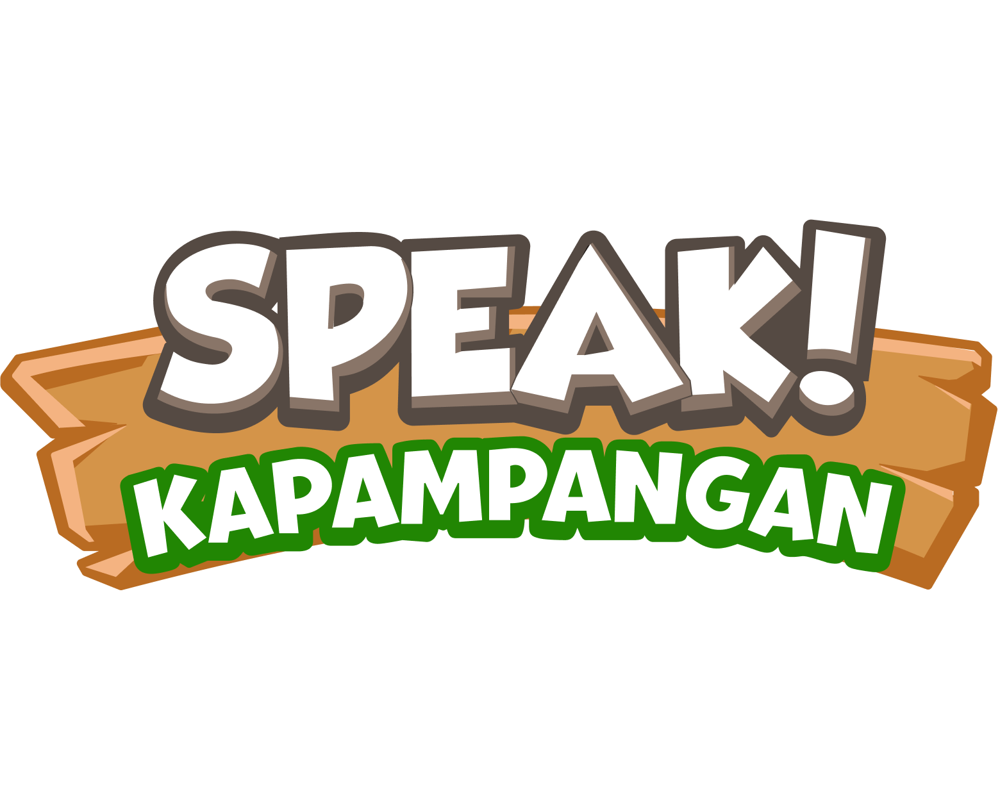
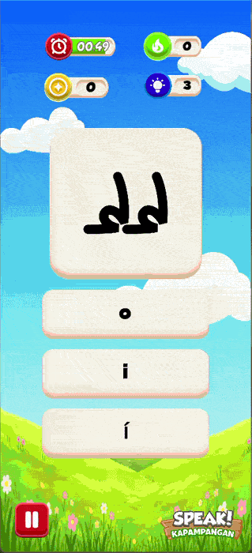
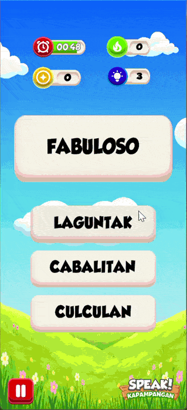
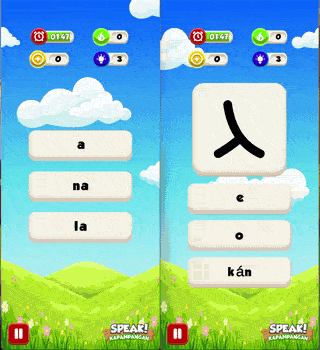
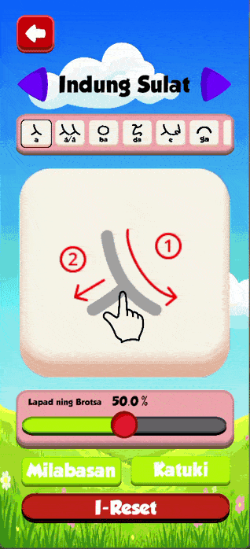
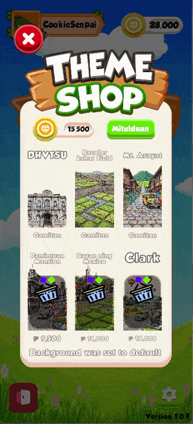
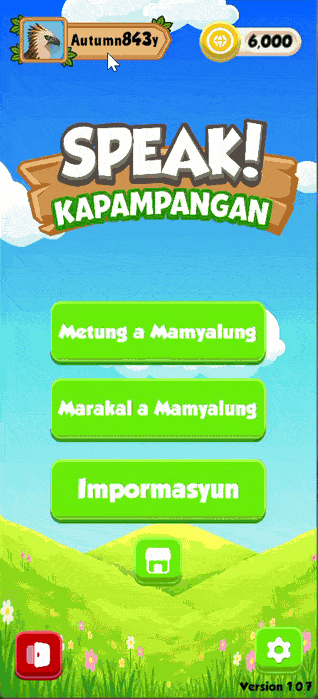
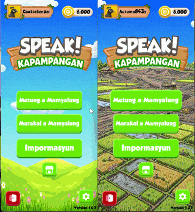

<p align="center">
  
</p>

<h1 align="center">SPEAK! KAPAMPANGAN</h1>

<p align="center">
  A 2D Flashcard-Based Language Learning Quiz Game
  with Multiplayer Collaborative Learning
</p>

<p align="center">
  
  
  
  
</p>

---

## 📑 Table of Contents

- [About the Project](#-about-the-project)
- [Project Objectives](#-project-objectives)
- [Features](#-features)
  - [Single Player Mode](#single-player-mode)
  - [Multiplayer Mode](#multiplayer-mode)
  - [General Features](#general-features)
- [Screenshots and Gameplay Demonstrations](#-screenshots-and-gameplay-demonstrations)
- [Technologies Used](#️-technologies-used)
- [Download and Play](#-download-and-play)
- [Installation and Setup](#️-installation-and-setup)
- [Repository Structure](#-repository-structure)
- [Development Team](#-development-team)
- [License](#-license)

---

## 📖 About the Project

**SPEAK! KAPAMPANGAN** is a 2D educational flashcard-based language learning game developed using the Unity Engine. It aims to promote the learning and appreciation of the **Kapampangan language** and its traditional writing system, **Kulitan**, through interactive flashcards, vocabulary quizzes, and engaging learning activities.

The game offers two primary learning modes: **Single Player** and **Multiplayer**.

The Single Player mode provides interactive vocabulary and Kulitan script learning activities. It also incorporates a **Rule-Based Guessing Detection System** designed to identify and evaluate potential guessing behavior during quiz activities, supporting the assessment of individual learning performance.

Meanwhile, the Multiplayer mode promotes collaborative learning by allowing players to participate in language-learning activities together through network-based gameplay.

SPEAK! KAPAMPANGAN aims to make Kapampangan language learning more accessible, interactive, and engaging while introducing learners to the cultural heritage of the Kapampangan people through the traditional Kulitan writing system.

This project was developed as part of the academic capstone requirement for the **Bachelor of Science in Information Technology (BSIT)** program at **Pampanga State University**.

---

## 🎯 Project Objectives

- Provide an interactive and engaging environment for learning the Kapampangan language.
- Reinforce Kapampangan vocabulary acquisition through flashcard-based learning and quiz activities.
- Introduce and encourage familiarity with the traditional Kulitan writing system.
- Encourage collaborative learning through multiplayer functionality.
- Implement a rule-based guessing detection mechanism in Single Player mode to evaluate player responses and support the learning assessment process.
- Promote appreciation of Kapampangan linguistic and cultural heritage through an educational gaming experience.

---

## ✨ Features

### Single Player Mode

- **Interactive Flashcards** – Provides flashcard-based learning activities to help users familiarize themselves with Kapampangan vocabulary.
- **Vocabulary Quizzes** – Allows players to assess their knowledge of Kapampangan words and their meanings.
- **Kulitan Script Learning** – Introduces players to the traditional Kulitan writing system through interactive learning activities.
- **Rule-Based Guessing Detection** – Evaluates player responses using predefined rules to identify potential guessing behavior during quiz activities.
- **Individual Learning and Assessment** – Provides an individual learning experience through interactive quizzes and activities.

### Multiplayer Mode

- **Multiplayer Quiz Activities** – Allows multiple players to participate in language-learning activities.
- **Collaborative Learning** – Encourages players to learn and participate together through shared quiz experiences.
- **Network-Based Gameplay** – Utilizes the Mirror networking framework to support multiplayer functionality.

### General Features

- **2D Game Interface** – Provides an interactive and accessible educational gaming environment.
- **User-Friendly Navigation** – Offers an interface designed for accessible gameplay.
- **Player Profile** – Provides player profile functionality.
- **In-Game Shop** – Allows players to access the game's shop features.
- **Kulitan Script Tracing** – Allows players to practice tracing traditional Kulitan characters.
- **Interactive Tutorials** – Introduces players to the game's mechanics and activities.

---


## 📸 Screenshots and Gameplay Demonstrations

The following GIFs showcase the different functionalities, learning activities, and interfaces of SPEAK KAPAMPANGAN.

### Single Player Mode

<table align="center">
  <tr>
    <td align="center">
      <b>Kulitan Script Learning</b><br><br>
      
    </td>
    <td align="center">
      <b>Kapampangan Vocabulary</b><br><br>
      
    </td>
  </tr>
</table>

### Multiplayer Mode

<p align="center">
  
</p>

### Rule-Based Guessing Detection

<p align="center">
  
</p>

### Kulitan Script Tracing

<p align="center">
  
</p>

### General Game Features

<table align="center">
  <tr>
    <td align="center">
      <b>In-Game Shop</b><br><br>
      
    </td>
    <td align="center">
      <b>Player Profile</b><br><br>
      
    </td>
  </tr>
</table>

### Multiplayer Tutorial

<p align="center">
  
</p>

---

## 🛠️ Technologies Used

| Technology | Purpose |
|---|---|
| Unity Engine 6000.4.3f1 | Game development engine |
| C# | Primary programming language |
| Visual Studio Code | Code editor |
| Mirror | Multiplayer networking framework |

---

## 🎮 Download and Play

A playable build of SPEAK KAPAMPANGAN is available for testing.

- **Version:** 1.0.7
- **Platform:** Android
- **Download:** [Download SPEAK KAPAMPANGAN](https://friv.com)

Please refer to the provided installation instructions before running the application.

---

## ⚙️ Installation and Setup

### Prerequisites

Before opening the project, ensure that you have the following installed:

- Unity Hub
- Unity Editor **6000.4.3f1**
- Visual Studio Code or another compatible C# IDE
- Git (optional, for cloning the repository)

### Installation Steps

1. Clone the repository or download it as a ZIP file.

   ```bash
   git clone https://github.com/username/SPEAK-KAPAMPANGAN.git
   ```

2. Open Unity Hub.

3. Select **Add Project from Disk**.

4. Navigate to the cloned or downloaded project directory.

5. Open the project using Unity Editor **6000.4.3f1**.

6. Allow Unity to import the required assets and restore the necessary packages.

7. Open the main game scene located in the `Assets/Scenes/` directory.

8. Press the **Play** button to run the game.

**Note:** This repository contains selected Unity source files and essential assets to minimize repository size. Unity-generated files and unnecessary build artifacts have been excluded. Required third-party packages, including Mirror, must be restored through the Unity Package Manager.

---

## 📁 Repository Structure

```text
SPEAK-KAPAMPANGAN/
│
├── Assets/
│   ├── Fonts/
│   ├── Localization/
│   ├── Prefab/
│   ├── Resources/
│   ├── Scenes/
│   ├── Scripts/
│   ├── Texture/
│   └── *.meta
│
├── Packages/
│   ├── manifest.json
│   └── packages-lock.json
│
├── ProjectSettings/
│
├── img/
│   ├── Logo.png
│   └── Screenshots/
│
├── README.md
└── .gitignore
```

*Note: The directory structure above represents the main folders included in the repository. Actual files and subdirectories may vary.*

---

## 👥 Development Team

| Name | Role |
|---|---|
| Jasper Capulong | Game Developer |
| Alex Andrew Vital | UI/UX Designer |
| Sophia Pamintuan | Technical Writer |
| Jordan Rupert Sibug | Technical Writer |
| Juro Camacho | Technical Writer |
| Niko Escoto | Technical Writer |
| Raquel Santos | Technical Writer |

### Team Contributions

- **Game Developer:** Responsible for game programming, implementation of gameplay mechanics, integration of game systems, and multiplayer functionality.
- **UI/UX Designer:** Responsible for interface design, visual layout, and overall user experience.
- **Technical Writers:** Responsible for research papers, project documentation, questionnaires, and other academic materials.

---

## 📌 Project Status

- **Current Version:** 1.0.7
- **Build:** 1
- **Release Status:** Official

SPEAK KAPAMPANGAN was developed as an academic capstone project under the Bachelor of Science in Information Technology program at Pampanga State University.

---

## 📄 License and Usage

This project was developed for academic and educational purposes.

The source code, assets, and other project materials are subject to the ownership and distribution agreements of the project developers and their institution.

Please obtain permission from the appropriate owners before redistributing or reusing project materials.

---

<p align="center">
  <b>SPEAK KAPAMPANGAN</b>
  <br>
  Promoting Kapampangan Language Learning and Cultural Appreciation Through Interactive Gaming.
</p>

<p align="center">
  <a href="#top">⬆ Back to Top</a>
</p>
